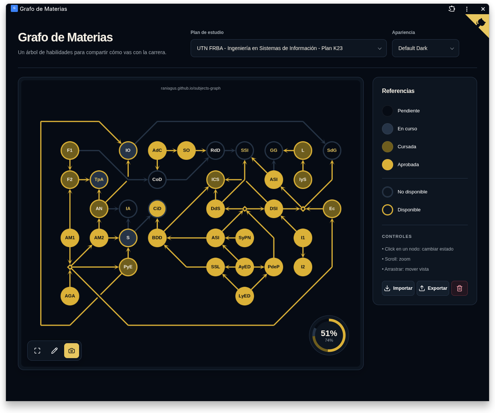

# Grafo de Materias

Aplicación web interactiva para visualizar correlativas de materias universitarias como un grafo
dirigido.




## Funcionalidades

- **Grafo interactivo** que permite configurar los estados de las materias con un click
- **Indicador de progreso** que muestra el avance por estado
- **Pan y zoom** para ver y recorrer desde dispositivos móviles
- **Autoguardado** en local storage para cada plan de estudio
- **Screenshots** para capturar el grafo en una imagen y subirlo en tu CV o perfil de GitHub
- **Selector de temas** para personalizar los colores del grafo
- **Import/Export** en JSON para respaldar y restaurar tu progreso
- **Progressive Web App (PWA)** para poder modificar el grafo offline desde cualquier dispositivo
  como si fuera una app nativa
- **Configuración extensible** de variantes de planes de estudio mediante un mismo archivo JSON
- **Modo edición** para agregar materias electivas o ingresar nuevos planes de forma más sencilla

## Aportes

¡Los aportes son bienvenidos! Podés ayudar:

- **Agregando nuevos planes de estudio** - Sumándolos a `data.json`
- **Reportando bugs** - Abrí un issue si algo no funciona como esperabas
- **Feature requests** - Cualquier idea que tengas para extender la app, también mediante issues

## Personalización

### Planes de estudio

El grafo soporta múltiples variantes de planes de estudio, cada una con su propia configuración de
materias, estados y disponibilidades:

```json
{
  "variants": {
    "tu-plan": {
      "name": "Universidad - Carrera - Plan",
      "progress": {...},
      "statuses": [...],
      "availabilities": [...],
      "subjects": [...],
      "edges": [...]
    },
    ...
  }
}
```

### Gráfico de progreso

Bajo el campo `progress` se puede configurar cómo se va a ver el gráfico de progreso.
Ejemplo:

```jsonc
"progress": {
  "position": {
    "vertical": "bottom", // o "top"
    "horizontal": "right" // o "left"
  }
}
```

### Estados de Materias

Los estados se configuran a nivel general en `statuses`. Ejemplo:

```json
"statuses": [
  { "id": "PENDING", "name": "Pendiente", "color": "--fill-color-1", "textColor": "--text-primary", "leafTextColor": "--accent-color" },
  { "id": "IN_PROGRESS", "name": "En curso", "color": "--fill-color-2", "textColor": "--text-primary", "leafTextColor": "--accent-color" },
  { "id": "FINAL_EXAM_PENDING", "name": "Cursada", "color": "--fill-color-3", "textColor": "--text-primary" },
  { "id": "APPROVED", "name": "Aprobada", "color": "--fill-color-4", "textColor": "--bg-primary" }
]
```

### Disponibilidad de Materias

Los bordes y flechas indican la disponibilidad y se configuran en `availabilities`. Ejemplo:

```json
"availabilities": [
  { "id": "NOT_AVAILABLE", "name": "No disponible", "color": "--border-color-2" },
  { "id": "ENROLL_AVAILABLE", "name": "Disponible para cursar", "color": "--border-color-3" },
  { "id": "FINAL_EXAM_AVAILABLE", "name": "Disponible para aprobar", "color": "--border-color-4" }
]
```

### Materias y correlativas

Las materias combinan estados y disponibilidades mediante correlativas. Cada materia tiene un
array de `prerequisites` que define cómo varía su disponibilidad basándose en el status de sus
dependencias.

Ejemplo de una materia con correlativas:

```json
{
  "id": "23",
  "name": "Economía",
  "shortName": "E",
  "position": { "x": 300, "y": 200 },
  "prerequisites": [
    {
      "availabilityId": "ENROLL_AVAILABLE",
      "dependencies": [
        { "statusId": "FINAL_EXAM_PENDING", "subjects": ["12"] },
        { "statusId": "APPROVED", "subjects": ["4", "5"] }
      ]
    },
    {
      "availabilityId": "FINAL_EXAM_AVAILABLE",
      "dependencies": [
        { "statusId": "APPROVED", "subjects": ["12"] }
      ]
    }
  ]
}
```

Esto indica que la materia "Economía" estará disponible para cursar si "Análisis de Sistemas" está
en estado "Cursada" y tanto "Algoritmos y Estructuras de Datos" como "Sistemas y Organizaciones"
están "Apobadas".

Las correlativas se evalúan en orden, es decir que para que "Economía" esté disponible para rendir
final es necesario cumplir con todos los requisitos anteriores y además tener "Análisis de Sistemas"
aprobada.

### Conectores

Los conectores permiten juntar las correlativas de varias materias en un solo nodo, que se simboliza
con forma de diamante. Se definen en `edges` y pueden encadenarse para rutas complejas.

Ejemplo de conector:

```json
{
  "id": "AM1,AGA:AM2,PyE",
  "position": { "x": 900, "y": 200 },
  "dependencies": ["1", "2"],
  "targets": ["10", "17"]
}
```

> Como normalmente los IDs de cada materia son numéricos, es recomendable que el ID del conector
> incluya los `shortName`s de las materias para poder identificarlos más fácil en el grafo.

Los conectores pueden encadenarse para mejorar la legibilidad del grafo.
Ejemplo:

```json
{ "id": "F2:TdC:1", "dependencies": ["F2"], "targets": ["F2:TdC:2"], ... },
{ "id": "F2:TdC:2", "dependencies": ["F2:TdC:1"], "targets": ["30"], ... }
```

> Los conectores que solamente tengan un origen y un destino se renderizan como
> **nodos invisibles**.

## Tech Stack

- **HTML5**, **CSS3** y **JavaScript Vanilla** (ES6+) - Núcleo de la aplicación
- **LocalStorage** - Persistencia de progreso en tiempo real en el navegador
- [**Cytoscape.js**](https://js.cytoscape.org/) - Biblioteca de renderizado de grafos
- [**Lucide**](https://lucide.dev/) - Iconos de UI
- [**Github Corners**](https://github.com/tholman/github-corners) - Banner "Fork me on GitHub"

La web no usa frameworks ni requiere compilación: se sirve directamente desde `public/`.
El mismo código del grafo se distribuye también como biblioteca ESM para integrar en otras webs.

## Infraestructura

- **Progressive Web App (PWA)** - Soporte offline y experiencia nativa
- **Vitest y TypeScript** - Pruebas y comprobación de JavaScript con JSDoc
- **esbuild** - Empaquetado de la biblioteca y declaraciones `.d.ts` generadas desde JSDoc
- **GitHub Actions** - Verificación de tests, tipos y build de la biblioteca

## Getting Started

### Instalación

```bash
git clone https://github.com/RaniAgus/subjects-graph.git
cd subjects-graph
```

### Estructura de archivos

```txt
subjects-graph/
├── public/
│   ├── index.html           # HTML principal
│   ├── app.js               # Lógica de aplicación (UI, eventos)
│   ├── graph.js             # Reexportación compatible del núcleo puro
│   ├── styles.css           # Estilos
│   ├── data.json            # Variantes y datos de cada plan de estudio
│   ├── lib/subjects-graph/  # Biblioteca, núcleo puro, renderer privado y CSS
│   └── icons/               # Iconos de la app
├── tests/                   # Pruebas unitarias (Vitest)
│   ├── bugs/                # Pruebas de regresión sobre bugs reportados
│   └── graph.test.js        # Pruebas de la lógica del grafo
├── README.md
└── LICENSE
```

### Ejecutar Localmente

Levantar la carpeta `public/` con cualquier servidor de archivos estáticos:

- Con Python 3:

```bash
python -m http.server 8000 -d public
```

- Con Node.js (serve):

```bash
npx serve public
```

- Con [VS Code Live Server Extension](https://marketplace.visualstudio.com/items?itemName=ritwickdey.LiveServer),
abrir `public/index.html` y hacer click en "Go Live".

Para desarrollar sin registrar el service worker, abrir
[http://localhost:8000/?pwa=off](http://localhost:8000/?pwa=off) y mantener `pwa=off` en la URL.
Las demás URLs conservan el comportamiento PWA habitual.

Si ya usaste la app localmente con PWA, hacer una única limpieza manual en DevTools:
en **Application > Service Workers**, pulsar **Unregister** para el service worker de esta app
y luego recargar. Recargar por sí solo no elimina el registro. Si hace falta, borrar también
las cachés `subjects-graph-cache-*` en **Application > Cache Storage**. Conservar Local Storage
para mantener el progreso, el tema y los planes personalizados.

### Ejecutar Unit Tests

Primero debemos instalar las dependencias con [pnpm](https://pnpm.io/):

```bash
pnpm install --frozen-lockfile
```

Luego podemos correr las pruebas directamente desde el IDE o con:

```bash
pnpm test
pnpm typecheck
pnpm build:lib
```

`pnpm start` sirve `public/` en el puerto 8000. No hay servidor de desarrollo Vite,
build de la web ni demo separada. `build:lib` genera ESM, CSS y declaraciones en
`dist/` (ignorado por Git); no modifica la web. El paquete incluye `dist/`, README,
LICENSE y los metadatos npm. `prepack` ejecuta ese build automáticamente; si tu
configuración omite scripts, para empaquetar este proyecto conocido usá
`npm pack --ignore-scripts=false`. No hace falta habilitar scripts globalmente.

## Usar la biblioteca

Podés integrar el grafo en tu propia app con `@raniagus/subjects-graph`.
La biblioteca dibuja las materias y sus correlativas; tu app define el plan,
acepta los cambios de progreso y decide cómo guardarlos.

### Instalación

Si tu proyecto usa un empaquetador que admite imports de CSS, instalá el paquete:

```bash
npm install @raniagus/subjects-graph
```

### Integración

Tu app debe proporcionar un contenedor `#graph` con dimensiones (por ejemplo,
`height: 600px`) y un archivo `plan.json` con estados, disponibilidades, materias
y correlativas. La [referencia de la API](https://github.com/RaniAgus/subjects-graph/blob/main/docs/library-api.md#plan-y-progreso)
describe su estructura.

```js
import { SubjectsGraph } from '@raniagus/subjects-graph';
import '@raniagus/subjects-graph/styles.css';
import plan from './plan.json' with { type: 'json' };

let progress = {};
const graph = new SubjectsGraph(document.querySelector('#graph'), { plan, progress });

graph.addEventListener('statusrequest', event => {
  const { subjectId, nextStatusId } = event.detail;
  progress = { ...progress, [subjectId]: nextStatusId };
  graph.setProgress(progress);
});
```

### Progreso y eventos

El plan describe la carrera. `progress` guarda el estado personal de cada materia,
por ejemplo `{ '1': 'APPROVED' }`. El orden de `plan.statuses` define el ciclo
que recorre una materia al hacer clic.

El clic emite `statusrequest`: tu app acepta el cambio llamando a `setProgress`,
como muestra el ejemplo. Si no lo hace, el estado de la materia se mantiene.
Esto permite guardar el progreso en Local Storage o en un servidor desde tu app.
El ejemplo lo conserva en memoria, por lo que se pierde al recargar.

`graph.getProgress()` devuelve una copia con el estado de todas las materias.
`graph.setProgress(progress)` reemplaza el progreso completo; `graph.setProgress({})`
restaura los estados iniciales del plan.

### Temas

Pasá colores en la opción `theme` al crear el grafo, o cambialos después con
`setTheme`. Por ejemplo, sobre la instancia del ejemplo anterior:

```js
graph.setTheme({
  '--bg-primary': '#10141d',
  '--fill-color-1': '#334155',
  '--fill-color-4': '#22c55e',
  '--text-primary': '#f8fafc',
  '--border-color-4': '#22c55e'
});
```

Los nombres como `--fill-color-4` son los tokens usados por los estados del plan.
Cada llamada a `setTheme` reemplaza las personalizaciones anteriores; los colores
omitidos usan la paleta Default Dark. `graph.setTheme({})` restaura esa paleta.
El tema afecta sólo a esa instancia, así que podés mostrar varios grafos con temas distintos.

Para reemplazar planes, habilitar edición, exportar PNG o liberar la instancia,
consultá la [referencia de la API](https://github.com/RaniAgus/subjects-graph/blob/main/docs/library-api.md).

En [examples/cdn](https://github.com/RaniAgus/subjects-graph/tree/main/examples/cdn)
hay dos ejemplos que consumen el paquete publicado sin instalar dependencias ni compilar:

- [Quickstart mínimo](https://github.com/RaniAgus/subjects-graph/tree/main/examples/cdn/minimal):
  lo indispensable para mostrar un grafo y aceptar cambios de estado.
- [Integración completa](https://github.com/RaniAgus/subjects-graph/tree/main/examples/cdn/complete):
  un recorte del K23 con tabla sincronizada en ambos sentidos, temas, edición,
  cambio de plan, exportación PNG y creación y destrucción de la instancia.

Sus README incluyen los pasos para ejecutarlos con un servidor estático.

## Licencia

Licencia BSD 3-Clause - ver [LICENSE](LICENSE)

---

Made with :heart: by [@RaniAgus](https://github.com/RaniAgus)

### Gauge opcional

Activá el anillo de progreso con `progressGauge: true` en el constructor.
Usa todos los estados de `plan.statuses`, sus colores y el tema del grafo.
Cada tramo representa materias en ese estado; los dos textos predeterminados
representan el último y penúltimo estado acumulados con los posteriores,
excluyendo el primero. Con dos estados se muestra un único porcentaje.

```js
graph.setProgressGauge({
  position: { vertical: 'bottom', horizontal: 'right' },
  offset: { x: 30, y: 30 },
  labels: { primary: 'APPROVED', secondary: 'FINAL_EXAM_PENDING' },
});
```

Los IDs son los del catálogo del plan. Cada texto acepta `false` para ocultarlo;
un ID inexistente también se oculta. Sin opciones de posición se usa
`plan.progress.position`, o inferior derecha, con separación de 30 píxeles.
`setProgressGauge(false)` lo desactiva; cada llamada reemplaza las opciones.
Se actualiza con el plan, progreso y tema, y aparece en `exportPNG()`.
En modo editable emite `editrequest` con `{ kind: 'progress' }` al activarlo.
